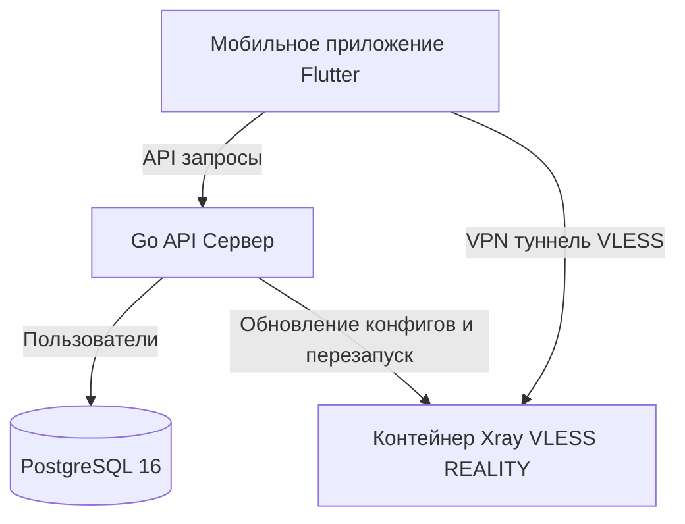

# VPN-сервис на основе Xray (VLESS + REALITY)

Этот репозиторий содержит полный исходный код для создания кроссплатформенного VPN-сервиса (клиент для iOS и Android на Flutter, бэкенд API на Go с базой данных PostgreSQL 16 и туннель безопасности на основе Xray).

---

## Архитектура системы



1. **Мобильный клиент (Flutter):** Использует плагин `flutter_v2ray` для интеграции Xray-ядра на уровне системы. Интерфейс блокирует подключение до тех пор, пока пользователь не посмотрит видеорекламу (клиентский инфорсмент). После этого туннель запускается без ограничений по времени.
2. **Бэкенд (Go):** Отвечает за регистрацию уникальных устройств, привязку UUID для VLESS, отслеживание логов подключений и динамическую генерацию конфигурационного файла `config.json` для Xray.
3. **VPN-ядро (Xray):** Обеспечивает высокопроизводительное и скрытное VPN-соединение по протоколу VLESS с маскировкой под популярные веб-ресурсы (REALITY XTLS Vision).

---

## Структура репозитория

```
├── .gitignore             # Корневой файл исключений Git
├── README.md              # Документация проекта
├── server/                # Серверная часть (Go API + Xray Docker)
│   ├── docker-compose.yml # Оркестрация контейнеров бэкенда и Xray
│   ├── Dockerfile         # Docker-образ для Go API
│   ├── main.go            # Точка входа API сервера
│   ├── db.go              # Подключение и инициализация PostgreSQL
│   ├── xray_manager.go    # Генерация X25519 ключей и управление Xray
│   └── xray/
│       └── config.template.json # Шаблон конфигурации Xray
└── client/                # Мобильное приложение (Flutter)
```

---

## Запуск серверной части

### Требования
- Установленный Docker и Docker Compose.
- Доступ к базе данных PostgreSQL 16.

### Инструкция по развертыванию
1. Перейдите в папку `server/`:
   ```bash
   cd server
   ```
2. Настройте переменные окружения в `docker-compose.yml` (раздел `environment` сервиса `vpn-api`):
   - `DB_HOST`: Хост PostgreSQL (например, `host.docker.internal` или IP вашего сервера).
   - `DB_PORT`: Порт PostgreSQL (по умолчанию `5432`).
   - `DB_USER`: Имя пользователя БД.
   - `DB_PASSWORD`: Пароль пользователя БД.
   - `DB_NAME`: Имя базы данных (например, `vpn_service`).
   - `VPN_SERVER_IP`: Публичный IP-адрес вашего сервера (VDS).
   - `VPN_SERVER_PORT`: Порт, на котором будет висеть Xray (по умолчанию `8443`).
   - `VPN_SERVER_NAME`: Отображаемое имя локации сервера в приложении (например, "Германия").
3. Запустите контейнеры:
   ```bash
   docker-compose up -d --build
   ```
4. Бэкенд автоматически создаст таблицы в PostgreSQL, сгенерирует приватный и публичный ключ для REALITY (сохранит в `server/xray/keys.json`) и запишет начальный `config.json` для Xray.

---

## Запуск мобильного приложения (Flutter)

### Требования
- Установленный Flutter SDK (версии 3.12.x или новее).
- Настроенный Xcode (для iOS) и Android Studio / SDK (для Android).

### Инструкция по запуску
1. Перейдите в папку `client/` и обновите конфигурационный адрес сервера в файле `lib/providers/vpn_provider.dart` (`_apiUrl`):
   - Для тестирования на Android Emulator укажите `http://10.0.2.2:8080`.
   - Для тестирования на iOS Simulator укажите `http://localhost:8080`.
   - Для продакшна укажите домен или публичный IP-адрес вашего API.
2. Скачайте зависимости:
   ```bash
   flutter pub get
   ```
3. Запустите приложение:
   ```bash
   flutter run
   ```
