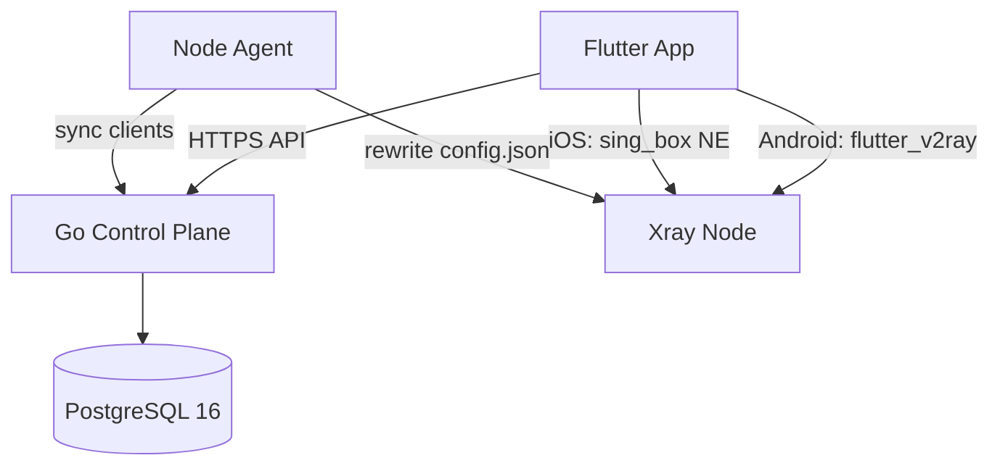
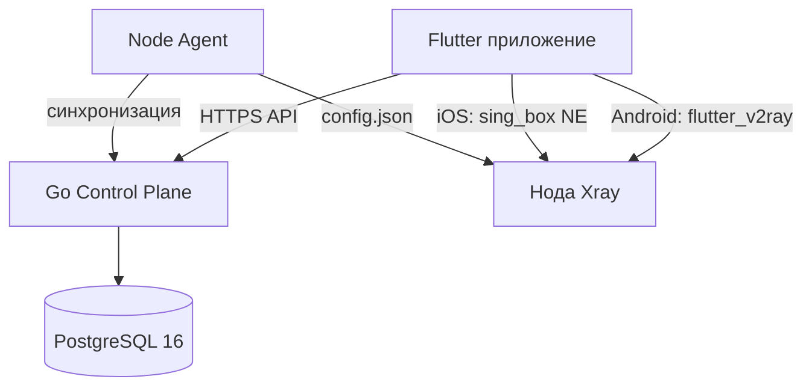

# Barys VPN — VLESS + REALITY

Cross-platform VPN service: Flutter mobile app (Android + iOS), Go control-plane API with PostgreSQL 16, and Xray nodes managed by per-node agents.

**Production app name:** Barys VPN  
**Bundle ID:** `dev.rudnowski.freevpn`

---

## System Architecture



1. **Mobile client (Flutter):** Android uses `flutter_v2ray`; iOS uses a custom `sing_box` plugin with Apple's Network Extension (`NEPacketTunnelProvider`). A rewarded ad must be watched before connecting (Google AdMob). No session time limits after the ad.
2. **Control plane (Go):** Registers devices, assigns VLESS UUIDs, stores server list, logs connection timestamps, and exposes an admin dashboard.
3. **Node agent (`agent/`):** Runs on every VPN node next to Xray. Generates REALITY keys, self-registers with the control plane, pulls the full user list, rewrites local `config.json`, and restarts Xray when clients change.
4. **VPN core (Xray):** VLESS + REALITY (XTLS Vision), camouflaged as legitimate TLS traffic (e.g. `images.apple.com`).

---

## Repository Structure

```
├── README.md
├── docs/
│   ├── privacy-policy.md              # Privacy policy (RU/EN, source)
│   ├── promo-site-brief.md              # Promo website spec
│   └── export-compliance-self-classification.md  # Apple/BIS encryption report
├── server/                            # Control plane + local node stack
│   ├── docker-compose.yml             # vpn-db, vpn-api, xray, vpn-agent
│   ├── Dockerfile
│   ├── main.go                        # Client + node + admin endpoints
│   ├── db.go                          # Postgres: vpn_users, servers
│   ├── admin.go                       # /admin dashboard + /api/stats
│   └── xray/
│       └── config.template.json
├── agent/                             # Node agent (deploy on every VPN node)
│   ├── main.go
│   ├── Dockerfile
│   ├── docker-compose.node.yml        # Template for a new remote node
│   └── xray/config.template.json
└── client/                            # Flutter app (Barys VPN)
    ├── lib/
    ├── android/                       # Release signing via key.properties
    ├── ios/
    │   └── SINGBOX_IOS_SETUP.md       # Network Extension setup guide
    └── plugins/sing_box/              # iOS VPN plugin (sing-box / Libbox)
```

---

## API Endpoints

| Endpoint | Method | Auth | Description |
|----------|--------|------|-------------|
| `/api/register` | POST | — | Register device, return UUID + server list |
| `/api/connect` | POST | — | Log connection timestamp |
| `/api/delete` | POST | — | Delete user data by `device_id` |
| `/api/health` | GET | — | Health check |
| `/api/nodes/register` | POST | Bearer `NODE_AGENT_TOKEN` | Node self-registration |
| `/api/nodes/clients` | GET | Bearer `NODE_AGENT_TOKEN` | Full UUID list for Xray sync |
| `/admin` | GET | — | Admin dashboard (token entered in browser) |
| `/api/stats` | GET | Bearer `ADMIN_TOKEN` | Usage statistics (JSON) |

Production API is served over HTTPS via a reverse proxy, e.g. `https://your-domain.com/vpn/api/...`.

---

## Multi-server Architecture

- **Control plane** (`server/`): Go API + Postgres. Clients call `/api/register` and receive every enabled server. Node agents use token-protected endpoints to sync.
- **Node agent** (`agent/`): One instance per VPN node. Generates REALITY keys, registers itself, periodically pulls all user UUIDs, updates local Xray config, restarts Xray on change.
- **`servers` table:** Stores each node (name, ip, port, public_key, short_id, sni).

### Adding a New Node

1. Provision a VDS with Docker; open port `8443/tcp`.
2. Copy the `agent/` folder to the new server.
3. Edit `agent/docker-compose.node.yml`: set `NODE_NAME`, `NODE_IP`, `API_URL`, `NODE_AGENT_TOKEN`.
4. Run: `docker compose -f docker-compose.node.yml up -d --build`
5. The new location appears in the app automatically on the next register call — no app update needed.

---

## Running the Server

### Requirements

- Docker and Docker Compose
- Port `8080` (API, bind to localhost in production) and `8443` (Xray)

### Deployment

1. Go to `server/`:
   ```bash
   cd server
   ```
2. Set environment variables in `docker-compose.yml` under `vpn-api`:
   - `DB_HOST`, `DB_PORT`, `DB_USER`, `DB_PASSWORD`, `DB_NAME`, `DB_SSLMODE`
   - `PORT` — API listen port (default `8080`)
   - `NODE_AGENT_TOKEN` — shared secret for node agents
   - `ADMIN_TOKEN` — secret for the admin dashboard
3. Start:
   ```bash
   docker compose up -d --build
   ```
4. Postgres tables (`vpn_users`, `servers`) are created automatically on first run.

### HTTPS (Production)

Expose the API only through a reverse proxy (nginx/Caddy) on HTTPS. Example nginx location:

```nginx
location /vpn/ {
    proxy_pass http://127.0.0.1:8080/;
}
```

The trailing slash strips the `/vpn` prefix. Keep port `8080` bound to localhost, not the public internet.

### Admin Dashboard

Open `/admin` (or `/vpn/admin` behind the proxy). Enter `ADMIN_TOKEN` — it is stored in the browser. Shows total devices, DAU/WAU/MAU, new registrations, and a 30-day chart. Auto-refreshes every 30 seconds.

---

## Running the Mobile App

### Requirements

- Flutter SDK 3.12+
- Xcode (iOS) with Network Extension capability — see `client/ios/SINGBOX_IOS_SETUP.md`
- Android Studio / SDK (Android)

### API URL

Set `_apiUrl` in `client/lib/providers/vpn_provider.dart`:

| Environment | URL |
|-------------|-----|
| Android emulator | `http://10.0.2.2:8080` |
| iOS simulator | `http://localhost:8080` |
| Production | `https://your-domain.com/vpn` |

### Run

```bash
cd client
flutter pub get
flutter run
```

For iOS Network Extension debugging, prefer `flutter run --profile` over debug.

### Release Builds

**Android** — configure `client/android/key.properties` (not in git), then:

```bash
flutter build appbundle --release   # Google Play (AAB)
flutter build apk --release         # Direct distribution (APK)
```

**iOS:**

```bash
flutter build ipa --release
```

Upload the IPA via Transporter or Xcode Organizer. VPN apps require an Apple **Organization** developer account (Individual accounts are rejected under guideline 5.4).

---

## Documentation

| File | Description |
|------|-------------|
| `docs/privacy-policy.md` | Privacy policy source (RU/EN) |
| `docs/promo-site-brief.md` | Promo website technical spec |
| `docs/export-compliance-self-classification.md` | U.S. export encryption self-classification (Apple/BIS) |
| `client/ios/SINGBOX_IOS_SETUP.md` | iOS Network Extension + sing-box setup |

Published privacy policy: https://rudnowski.dev/projects/barys-vpn/privacy.html

---

---

# Barys VPN — VLESS + REALITY (Русская версия)

Кроссплатформенный VPN-сервис: мобильное приложение на Flutter (Android + iOS), control plane на Go с PostgreSQL 16, VPN-ноды на Xray с агентами синхронизации.

**Название приложения:** Barys VPN  
**Bundle ID:** `dev.rudnowski.freevpn`

---

## Архитектура



1. **Мобильный клиент (Flutter):** Android — `flutter_v2ray`; iOS — плагин `sing_box` с Network Extension (`NEPacketTunnelProvider`). Перед подключением показывается rewarded-реклама (Google AdMob). После просмотра — без ограничений по времени.
2. **Control plane (Go):** Регистрация устройств, выдача VLESS UUID, список серверов, логирование подключений, админ-панель.
3. **Node agent (`agent/`):** На каждой VPN-ноде. Генерирует REALITY-ключи, регистрируется на control plane, периодически забирает список пользователей, обновляет `config.json` Xray и перезапускает его при изменениях.
4. **VPN-ядро (Xray):** VLESS + REALITY (XTLS Vision), маскировка под обычный TLS-трафик.

---

## Структура репозитория

```
├── README.md
├── docs/                              # Документация (политика, ТЗ сайта, export compliance)
├── server/                            # Control plane + локальная нода
│   ├── docker-compose.yml
│   ├── main.go, db.go, admin.go
│   └── xray/
├── agent/                             # Агент ноды (на каждом VPN-сервере)
│   ├── docker-compose.node.yml
│   └── ...
└── client/                            # Flutter-приложение Barys VPN
    ├── ios/SINGBOX_IOS_SETUP.md
    └── plugins/sing_box/
```

---

## API

| Endpoint | Метод | Авторизация | Описание |
|----------|-------|-------------|----------|
| `/api/register` | POST | — | Регистрация устройства, UUID + список серверов |
| `/api/connect` | POST | — | Лог времени подключения |
| `/api/delete` | POST | — | Удаление данных по `device_id` |
| `/api/health` | GET | — | Проверка работоспособности |
| `/api/nodes/register` | POST | Bearer `NODE_AGENT_TOKEN` | Регистрация ноды |
| `/api/nodes/clients` | GET | Bearer `NODE_AGENT_TOKEN` | Список UUID для Xray |
| `/admin` | GET | — | Админ-панель (токен вводится в браузере) |
| `/api/stats` | GET | Bearer `ADMIN_TOKEN` | Статистика (JSON) |

В продакшене API доступен по HTTPS через reverse proxy, например `https://your-domain.com/vpn/api/...`.

---

## Мульти-серверная архитектура

- **Control plane** (`server/`): Go API + Postgres. Клиенты вызывают `/api/register` и получают все включённые серверы.
- **Node agent** (`agent/`): Один экземпляр на каждой VPN-ноде. Синхронизирует Xray с control plane.
- Таблица **`servers`**: имя, ip, port, public_key, short_id, sni.

### Добавление новой ноды

1. VDS с Docker, открыть порт `8443/tcp`.
2. Скопировать папку `agent/` на новый сервер.
3. В `docker-compose.node.yml` указать `NODE_NAME`, `NODE_IP`, `API_URL`, `NODE_AGENT_TOKEN`.
4. Запустить: `docker compose -f docker-compose.node.yml up -d --build`
5. Новая локация появится в приложении автоматически — обновление приложения не нужно.

---

## Запуск сервера

### Требования

- Docker и Docker Compose
- Порты `8080` (API, в продакшене — только localhost) и `8443` (Xray)

### Развёртывание

1. Перейти в `server/`:
   ```bash
   cd server
   ```
2. Настроить переменные в `docker-compose.yml` (сервис `vpn-api`):
   - `DB_HOST`, `DB_PORT`, `DB_USER`, `DB_PASSWORD`, `DB_NAME`, `DB_SSLMODE`
   - `PORT` — порт API (по умолчанию `8080`)
   - `NODE_AGENT_TOKEN` — секрет для агентов нод
   - `ADMIN_TOKEN` — секрет для админ-панели
3. Запуск:
   ```bash
   docker compose up -d --build
   ```
4. Таблицы Postgres создаются автоматически при первом запуске.

### HTTPS (продакшен)

API выставляется только через reverse proxy (nginx/Caddy) по HTTPS. Пример:

```nginx
location /vpn/ {
    proxy_pass http://127.0.0.1:8080/;
}
```

Порт `8080` держать на localhost, не открывать наружу.

### Админ-панель

Открыть `/admin` (или `/vpn/admin` за прокси). Ввести `ADMIN_TOKEN` — сохранится в браузере. Показывает: всего устройств, DAU/WAU/MAU, новые регистрации, график за 30 дней. Обновление каждые 30 секунд.

---

## Запуск мобильного приложения

### Требования

- Flutter SDK 3.12+
- Xcode (iOS) с Network Extension — см. `client/ios/SINGBOX_IOS_SETUP.md`
- Android Studio / SDK (Android)

### URL API

В `client/lib/providers/vpn_provider.dart` (`_apiUrl`):

| Окружение | URL |
|-----------|-----|
| Android emulator | `http://10.0.2.2:8080` |
| iOS simulator | `http://localhost:8080` |
| Продакшен | `https://your-domain.com/vpn` |

### Запуск

```bash
cd client
flutter pub get
flutter run
```

Для отладки iOS Network Extension лучше `flutter run --profile`, не debug.

### Релизные сборки

**Android** — настроить `client/android/key.properties` (не в git):

```bash
flutter build appbundle --release   # Google Play (AAB)
flutter build apk --release         # Прямая раздача (APK)
```

**iOS:**

```bash
flutter build ipa --release
```

Загрузка IPA через Transporter или Xcode Organizer. VPN-приложения требуют Apple-аккаунт типа **Organization** (Individual отклоняется по guideline 5.4).

---

## Документация

| Файл | Описание |
|------|----------|
| `docs/privacy-policy.md` | Политика конфиденциальности (RU/EN) |
| `docs/promo-site-brief.md` | ТЗ промо-сайта |
| `docs/export-compliance-self-classification.md` | Export compliance (Apple/BIS) |
| `client/ios/SINGBOX_IOS_SETUP.md` | Настройка iOS Network Extension |

Опубликованная политика: https://rudnowski.dev/projects/barys-vpn/privacy.html
