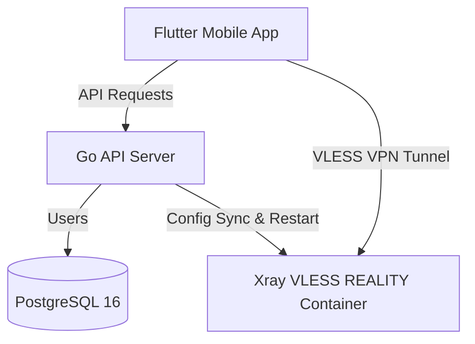
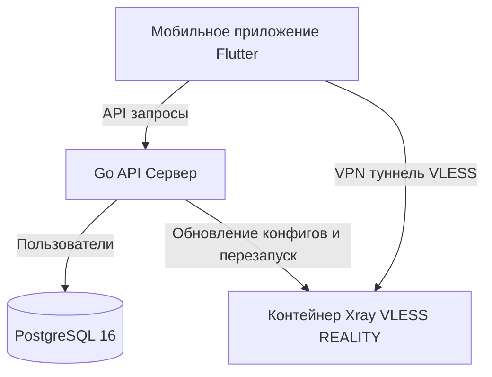

# VPN Service based on Xray (VLESS + REALITY)

This repository contains the complete source code for creating a cross-platform VPN service (iOS and Android client built with Flutter, Go-based backend API with PostgreSQL 16 database, and secure tunnel core using Xray).

---

## System Architecture



1. **Mobile Client (Flutter):** Integrates the Xray core at the system level using the `flutter_v2ray` plugin. The user interface requires watching a rewarded video ad before connecting (client-side enforcement). Once the ad is viewed, the VPN tunnel starts without any session time limits.
2. **Backend (Go):** Handles unique device registration, assigns VLESS UUIDs, logs connections, and dynamically updates Xray's `config.json` configuration file.
3. **VPN Core (Xray):** Provides high-performance, stealthy VPN connections using the VLESS protocol with REALITY XTLS Vision camouflage, mimicking legitimate websites (like `images.apple.com`).

---

## Repository Structure

```
├── .gitignore             # Root Git ignore file
├── README.md              # Project documentation (English & Russian)
├── server/                # Control plane (Go API + Postgres) + local node
│   ├── docker-compose.yml # Orchestrates db + api + xray + local node agent
│   ├── Dockerfile         # Dockerfile for the control-plane API
│   ├── main.go            # API: client register + node endpoints
│   ├── db.go              # Postgres init, `vpn_users` and `servers` tables
│   └── xray/
│       └── config.template.json # Xray template (used by the local node)
├── agent/                 # Node agent — runs on EVERY VPN node next to Xray
│   ├── main.go            # Keys + self-registration + Xray config sync loop
│   ├── Dockerfile
│   ├── docker-compose.node.yml # Template to deploy a NEW remote node
│   └── xray/config.template.json
└── client/                # Mobile client application (Flutter)
```

## Multi-server architecture

The system uses a **control plane + node agents** design:

- **Control plane** (`server/`): the Go API and Postgres. Clients call `/api/register`
  and get a list of every enabled server. It exposes token-protected endpoints
  `POST /api/nodes/register` and `GET /api/nodes/clients` for agents.
- **Node agent** (`agent/`): runs on every VPN node beside an Xray container.
  It generates/keeps that node's REALITY keys, self-registers with the control
  plane, then periodically pulls the full user list and rewrites the local
  `config.json`, restarting Xray only when the client list changes.
- The `servers` table stores each node (name, ip, port, public key, short id, sni).

### Adding a new server (node)

1. Provision a fresh VDS with Docker installed, and open the VPN port (default `8443/tcp`).
2. Copy the `agent/` folder to the new server.
3. In `agent/docker-compose.node.yml` set `NODE_NAME`, `NODE_IP` (public IP), and
   keep `NODE_AGENT_TOKEN` / `API_URL` pointing at the control plane.
4. Run: `docker compose -f docker-compose.node.yml up -d --build`.
5. The agent generates keys, self-registers, and the new location appears in the
   app automatically on the next `register` call — no code changes or app update needed.

---

## Running the Server

### Requirements
- Docker and Docker Compose installed.
- Access to a PostgreSQL 16 database.

### Deployment Instructions
1. Navigate to the `server/` directory:
   ```bash
   cd server
   ```
2. Configure the environment variables in `docker-compose.yml` (under the `environment` section of the `vpn-api` service):
   - `DB_HOST`: PostgreSQL database host (e.g. `host.docker.internal` or your server's IP).
   - `DB_PORT`: PostgreSQL port (default: `5432`).
   - `DB_USER`: Database username.
   - `DB_PASSWORD`: Database password.
   - `DB_NAME`: Database name (e.g., `vpn_service`).
   - `VPN_SERVER_IP`: Public IP address of your server (VDS).
   - `VPN_SERVER_PORT`: Port for the Xray service (default: `8443`).
   - `VPN_SERVER_NAME`: Location name displayed in the client app (e.g., "Germany").
3. Start the containers:
   ```bash
   docker-compose up -d --build
   ```
4. The backend will automatically create tables in PostgreSQL, generate X25519 keys for REALITY (saved in `server/xray/keys.json`), and write the final `config.json` for Xray.

---

## Running the Mobile Application (Flutter)

### Requirements
- Flutter SDK (version 3.12.x or newer).
- Configured Xcode (for iOS) and Android Studio / SDK (for Android).

### Running Instructions
1. Navigate to the `client/` directory and update the API URL constant in `lib/providers/vpn_provider.dart` (`_apiUrl`):
   - For Android Emulator tests, use `http://10.0.2.2:8080`.
   - For iOS Simulator tests, use `http://localhost:8080`.
   - For production, specify your API server domain or public IP.
2. Fetch dependencies:
   ```bash
   flutter pub get
   ```
3. Run the application:
   ```bash
   flutter run
   ```

---

# VPN-сервис на основе Xray (VLESS + REALITY) (Russian Version)

Этот репозиторий содержит полный исходный код для создания кроссплатформенного VPN-сервиса (клиент для iOS и Android на Flutter, бэкенд API на Go с базой данных PostgreSQL 16 и туннель безопасности на основе Xray).

---

## Архитектура системы



1. **Мобильный клиент (Flutter):** Использует плагин `flutter_v2ray` для интеграции Xray-ядра на уровне системы. Интерфейс блокирует подключение до тех пор, пока пользователь не посмотрит видеорекламу (клиентский инфорсмент). После этого туннель запускается без ограничений по времени.
2. **Бэкенд (Go):** Отвечает за регистрацию уникальных устройств, привязку UUID для VLESS, отслеживание логов подключений и динамическую генерацию конфигурационного файла `config.json` для Xray.
3. **VPN-ядро (Xray):** Обеспечивает высокопроизводительное и скрытное VPN-соединение по протоколу VLESS с маскировкой под популярные веб-ресурсы (REALITY XTLS Vision).

---

## Структура репозитория

```
├── .gitignore             # Корневой файл исключений Git
├── README.md              # Документация проекта
├── server/                # Серверная часть (Go API + Xray Docker)
│   ├── docker-compose.yml # Оркестрация контейнеров бэкенда и Xray
│   ├── Dockerfile         # Docker-образ для Go API
│   ├── main.go            # Точка входа API сервера
│   ├── db.go              # Подключение и инициализация PostgreSQL
│   ├── xray_manager.go    # Генерация X25519 ключей и управление Xray
│   └── xray/
│       └── config.template.json # Шаблон конфигурации Xray
└── client/                # Мобильное приложение (Flutter)
```

---

## Запуск серверной части

### Требования
- Установленный Docker и Docker Compose.
- Доступ к базе данных PostgreSQL 16.

### Инструкция по развертыванию
1. Перейдите в папку `server/`:
   ```bash
   cd server
   ```
2. Настройте переменные окружения в `docker-compose.yml` (раздел `environment` сервиса `vpn-api`):
   - `DB_HOST`: Хост PostgreSQL (например, `host.docker.internal` или IP вашего сервера).
   - `DB_PORT`: Порт PostgreSQL (по умолчанию `5432`).
   - `DB_USER`: Имя пользователя БД.
   - `DB_PASSWORD`: Пароль пользователя БД.
   - `DB_NAME`: Имя базы данных (например, `vpn_service`).
   - `VPN_SERVER_IP`: Публичный IP-адрес вашего сервера (VDS).
   - `VPN_SERVER_PORT`: Порт, на котором будет висеть Xray (по умолчанию `8443`).
   - `VPN_SERVER_NAME`: Отображаемое имя локации сервера в приложении (например, "Германия").
3. Запустите контейнеры:
   ```bash
   docker-compose up -d --build
   ```
4. Бэкенд автоматически создаст таблицы в PostgreSQL, сгенерирует приватный и публичный ключ для REALITY (сохранит в `server/xray/keys.json`) и запишет начальный `config.json` для Xray.

---

## Запуск мобильного приложения (Flutter)

### Требования
- Установленный Flutter SDK (версии 3.12.x или новее).
- Настроенный Xcode (для iOS) и Android Studio / SDK (для Android).

### Инструкция по запуску
1. Перейдите в папку `client/` и обновите конфигурационный адрес сервера в файле `lib/providers/vpn_provider.dart` (`_apiUrl`):
   - Для тестирования на Android Emulator укажите `http://10.0.2.2:8080`.
   - Для тестирования на iOS Simulator укажите `http://localhost:8080`.
   - Для продакшна укажите домен или публичный IP-адрес вашего API.
2. Скачайте зависимости:
   ```bash
   flutter pub get
   ```
3. Запустите приложение:
   ```bash
   flutter run
   ```
